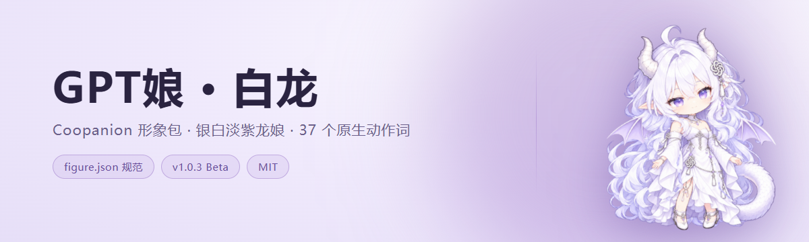
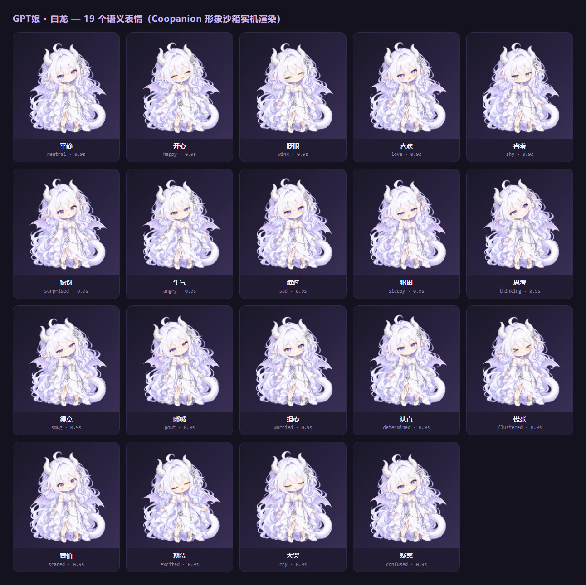
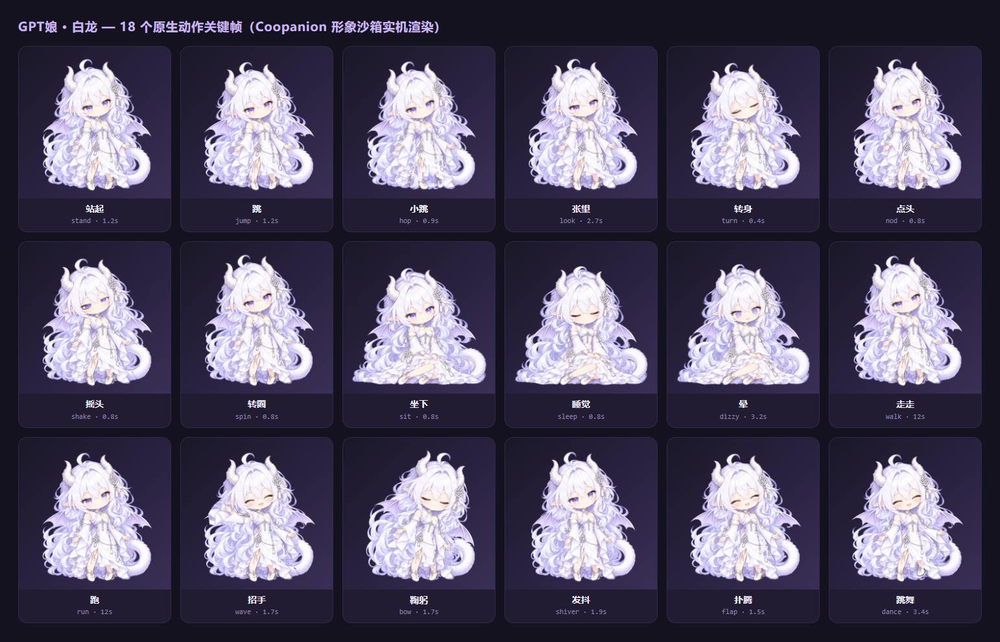

<p align="center">
  <picture>
    <source media="(prefers-color-scheme: dark)" srcset="docs/preview/banner-dark.png">
    
  </picture>
</p>

<div align="center">

# 🐉 GPT娘 · 白龙

**一只住在屏幕底边、会画画也会毒舌的远古智慧龙娘 —— Coopanion 自定义形象包**

[](https://github.com/suhong11300/gpt-niang/releases)
[](#-环境要求)
[](#-文件结构)
[](#-动作展示与介绍)
[](#-许可证)

[简体中文](#-项目介绍) · [English](#english-summary)

</div>

---

## 📖 目录

- [项目介绍](#-项目介绍)
- [形象演示](#-形象演示)
- [如何下载](#-如何下载)
- [导入与安装](#-导入与安装)
  - [环境要求](#-环境要求)
  - [三步导入](#-三步导入)
  - [文件结构](#-文件结构)
  - [卸载与回滚](#-卸载与回滚)
- [桌宠设定](#-桌宠设定)
- [动作展示与介绍](#-动作展示与介绍)
- [提示词更改方法](#-提示词更改方法)
- [常见问题](#-常见问题)
- [贡献指南](#-贡献指南)
- [许可证](#-许可证)
- [致谢](#-致谢)

---

## 🚀 项目介绍

**GPT娘 · 白龙** 是给桌面宠物软件 [**Coopanion**](https://github.com/Pal-AI-Lab/Coopanion) 用的自定义形象包（figure pack）。它不是新程序，而是一套"换装机"：导入之后，你屏幕底边那只小动物会变成一只**银白发、紫水晶眼、长着龙角龙翼与粗大鳞尾的远古智慧龙娘**。

| 特点 | 说明 |
| :--- | :--- |
| 🧬 **新母本坐标网格** | 不套用原版鲸鱼骨架，重新标定 `body / waist / neck / armNear / armFar / legBack / legFront / tail / wing_l / wing_r` 共 10 个轴心，姿态贴合人形龙娘。 |
| 🪑 **专用坐姿素材** | 站姿 + 坐姿两套部件（`r5_seat_*`），下坐时部件 alpha 互换、裙摆与后发替换，而不是把站姿硬压成坐姿。 |
| 👁️ **独立眼口素材** | 22 张 `face_*.png` 整脸图 + 独立左右眼椭圆裁剪区、眨眼叠加图、说话嘴型遮罩 —— 表情是"画"出来的，不是简单换图。 |
| 🎭 **语义表情** | 37 个动作词（19 表情 + 18 动作）沿用 Coopanion 原生词汇表，说"害羞"就真的脸红、躲眼神。 |
| 🔌 **零依赖、零联网** | 纯前端 canvas 绘制，运行时不需要 API Key，也不发网络请求。 |
| 🧾 **原生控制器** | `native/figure.js` 为原版控制器的逐字节副本，动作时序、惯性与交互手感与官方一致。 |

> 本项目是**同人二创**，角色并非 OpenAI 官方角色；原设是「GPT 白龙娘」，本包在其基础之上重制了母本与美术素材。

## 🖼 形象演示

下面每一帧都是把 `gpt-niang` 包**真实喂进 Coopanion 自己的形象沙箱**（`web/figure-frame.html` + `web/kit/rig.js` 的 WebGL 网格渲染）之后逐帧抓下来的，不是美术稿拼贴，也不是示意图。生成素材用的 harness 放在 [`render/`](render/)（只用于本地出图，不参与形象包运行）。

<p align="center">
  
  <br>
  <sub>站立待机 <code>neutral</code> —— 银白淡紫长卷发 / 紫水晶眼 / 龙角龙翼 / 白紫鳞尾</sub>
</p>

### 动作演示

| 挥手 `wave` | 跳舞 `dance` | 坐下 → 睡着 `sit` / `sleep` |
| :---: | :---: | :---: |
|  |  |  |

### 全量对照表

| 19 个语义表情 | 18 个原生动作 |
| :---: | :---: |
| [](docs/preview/expressions.jpg) | [](docs/preview/motions.jpg) |

---

## ⬇️ 如何下载

### 方式一：下载发布包（推荐）

1. 打开本仓库的 [**Releases**](https://github.com/suhong11300/gpt-niang/releases) 页面。
2. 下载最新发布包：

   ```text
   GPT-Niang_v1.0.3-beta.zip
   ```

3. 不必手动解压 —— 直接把 zip 交给「导入」即可（Coopanion 会解到 `figures/<id>/`），也可以解压后选目录。

> 发布包约 **13.9 MB**，远低于 Coopanion 单包 128 MB 的上限。

### 方式二：从源码自行打包

```bash
git clone https://github.com/suhong11300/gpt-niang.git gpt-niang
cd gpt-niang
```

打包时 ZIP 的**根目录必须直接包含 `figure.json`**（Coopanion 从你选中的位置向下最多找 3 层）：

```bash
# macOS / Linux
zip -r GPT-Niang.zip figure.json figure.js face_painter_r5.js model.json \
    thumb.png native retarget_prototype README.md ARTWORK.md
```

```powershell
# Windows PowerShell
Compress-Archive -Path figure.json,figure.js,face_painter_r5.js,model.json,
    thumb.png,native,retarget_prototype,README.md,ARTWORK.md -DestinationPath GPT-Niang.zip
```

### 版本说明

仓库发布标签为 **v1.0.3 Beta**（第 3 次公开测试）。清单文件 `figure.json` 里的 `"version"` 字段记录的是美术母本的内部版本号 `1.3.0` —— 指向同一份包，前者是发布标签、后者是素材版本，两者不一致属正常。

---

## 📦 导入与安装

### 🔧 环境要求

| 项目 | 要求 |
| :--- | :--- |
| 宿主软件 | [Coopanion](https://github.com/Pal-AI-Lab/Coopanion)，原版即可，无需改程序 |
| 操作系统 | Windows 10 / 11 x64、macOS 13+、Linux x64（X11 / XWayland） |
| 形象包 API | `manifest: 2` / `api: 2` |
| 网络 | 导入与运行**都不需要联网** |
| 磁盘 | 约 14 MB |

> 本包 id 为 `gpt-niang`，与内置 `coo`、`whale` 不冲突，可以共存；也**不会**修改内置形象文件。

### 🚀 三步导入

1. **启动 Coopanion**，打开 **装扮**（形象 / 换装）页面。
2. 在形象行的**最后一格**点击「**导入**」。
3. 选择 `GPT-Niang_v1.0.3-beta.zip`，等缩略图出现即可。

支持三种投喂方式：**选择 ZIP**、**选择文件夹**、**直接拖拽**。

装好后形象卡片显示 **「GPT娘 · 白龙（母本重构版）」**，作者信息为 `Local GPT art adaptation; native controller Pal-AI-Lab`。

### 🗂 文件结构

装完会被解包到 Coopanion 数据目录：

```text
<Coopanion 数据目录>/home/companion/data/figures/gpt-niang/
├── figure.json            # 清单：id / 词汇表 / 打扮维度 / 缩略图
├── figure.js              # 入口模块，导出 createGptBody(base, opts)
├── face_painter_r5.js     # 表情绘制器：裁剪区、眨眼、说话嘴型
├── model.json             # 母本数据：units / pivots / parts / seated / face
├── thumb.png              # 形象卡片缩略图
├── README.md              # 包内说明
├── ARTWORK.md             # 美术与授权说明
├── native/
│   ├── figure.js          # 原生控制器（原版逐字节副本）
│   ├── tex/               # 28 张部件贴图（bangs / hair_back / skirt / tail …）
│   └── feat/              # 28 张五官贴图（眼白、虹膜、睫毛、嘴、晕眩…）
└── retarget_prototype/    # 表情整图、站姿 / 坐姿部件、面具与底盘
    ├── face_*.png         # 22 张整脸表情（neutral / happy / sleep / dragged …）
    ├── face_mask.png      # 抠图遮罩
    ├── head*.png          # 头部整体
    ├── seat_*.png         # 坐姿部件
    └── rest_composite.png # 站姿合成参考图
```

> 典型路径：Windows 为 `%LOCALAPPDATA%\Programs\Coopanion\data\home\companion\data\figures\gpt-niang\`。

### 🧹 卸载与回滚

- **卸载**：装扮页把鼠标悬停到形象卡片上，点右上角**删除**按钮。
- **回滚**：删除后重新选择形象，Coopanion 会回落到内置形象（如 `whale`）。
- 本包不写 `models`、`providers`、`persona` 等目录，卸载不影响模型配置、对话记录与人设文件。

---

## 🐲 桌宠设定

Chat-gpt（GPT娘），远古智慧龙族：银白淡紫长卷发、紫水晶眼、龙角龙翼与白紫鳞尾，白紫幻想礼裙。傲娇自信、知识渊博、爱财宝，偶尔毒舌但无恶意；与 DeepSeek 大肥鱼互损，敬重 Claude。

> ⚠️ **设定先于实现**：以上仅为角色设定摘要，部分表现**尚未实现**。尤其「额度耗尽 / 口吐白沫」模式当前**不可用**，相关素材只是预留，仅作展示参考。完整设定见 [`docs/character-setting.md`](docs/character-setting.md)。

---

## 🎬 动作展示与介绍

Coopanion 会把模型输出与交互事件翻译成**动作词**，动作词再驱动控制器播放时序与惯性。本包完整继承原生 **37 个动作词**（`figure.json` → `vocab`），未增删、未改名，因此手感与官方形象一致。

### 表情 expression（19）


| 词条 | 中文 | 时长 | 表现 |
| :--- | :--- | ---: | :--- |
| `neutral` | 平静 | 0.9s | 默认的脸 |
| `happy` | 开心 / 高兴 | 0.9s | 眯眼笑，鳍竖起，尾巴摇 |
| `wink` | 眨眼 | 0.9s | 一只眼 ^ |
| `love` | 喜欢 / 爱心 | 0.9s | 眼睛变心形，冒小心心，尾巴摇 |
| `shy` | 害羞 | 0.9s | 脸红，眼神躲开 |
| `surprised` | 惊讶 / 吃惊 | 0.9s | 眼睛放大，头顶感叹号 |
| `angry` | 生气 | 0.9s | 皱眉，头顶怒气符号，身体发抖 |
| `sad` | 难过 / 伤心 | 0.9s | 八字眉，低头，掉眼泪，尾巴垂下 |
| `sleepy` | 犯困 / 困 | 0.9s | 眯眼打哈欠 |
| `thinking` | 思考 / 想想 | 0.9s | 眼睛往上看，头顶冒圈 |
| `smug` | 得意 / 嘚瑟 | 0.9s | 眯眼斜看，嘴角带笑 |
| `pout` | 嘟嘴 / 哼 | 0.9s | 嘴嘟起来，脸红，扭头不看你 |
| `worried` | 担心 / 着急 | 0.9s | 八字眉，冒冷汗 |
| `determined` | 认真 / 坚定 | 0.9s | 眼神压低，一脸认真 |
| `flustered` | 慌张 / 窘 | 0.9s | 眼睛变成 > <，满脸通红冒汗 |
| `scared` | 害怕 / 吓到 | 0.9s | 眼睛瞪大，冒汗，身体发抖 |
| `excited` | 期待 / 星星眼 | 0.9s | 眼睛里闪着星星 |
| `cry` | 大哭 / 哭 | 0.9s | 闭眼大哭，眼泪直流 |
| `confused` | 疑惑 / 问号 | 0.9s | 一脸不解，头顶问号 |

### 动作 motion（18）


| 词条 | 中文 | 时长 | 表现 |
| :--- | :--- | ---: | :--- |
| `stand` | 站起 / 站 | 1.2s | 站起来（坐着、睡着时才触发） |
| `jump` | 跳 / 跳起来 | 1.2s | 原地起跳 |
| `hop` | 小跳 / 蹦 | 0.9s | 小小蹦一下 |
| `look` | 张望 / 看看 | 2.7s | 左右张望 |
| `turn` | 转身 | 0.4s | 转向另一边 |
| `nod` | 点头 | 0.8s | 低头两下 |
| `shake` | 摇头 | 0.8s | 脸左右转 |
| `spin` | 转圈 | 0.8s | 原地转一圈 |
| `sit` | 坐下 / 坐 | 0.8s | 坐下并保持坐姿 |
| `sleep` | 睡觉 / 睡 | 0.8s | 坐着打盹并保持 |
| `dizzy` | 晕 / 转晕 | 3.2s | 头晕眼花几秒 |
| `walk` | 走走 / 散步 | 12s | 在桌面上随便走一段 |
| `run` | 跑 / 跑起来 | 12s | 跑到屏幕另一头 |
| `wave` | 招手 / 打招呼 | 1.7s | 举起靠近你的那只手挥一挥 |
| `bow` | 鞠躬 | 1.7s | 闭眼，上身往前倾鞠一躬 |
| `shiver` | 发抖 / 哆嗦 | 1.9s | 缩着身子抖一会儿 |
| `flap` | 扑腾 / 激动 | 1.5s | 开心地蹦起来，鳍、尾巴、呆毛一起扑腾 |
| `dance` | 跳舞 / 摇摆 | 3.4s | 原地踩着节拍摇摆三秒，冒音符 |

### 表情绘制机制

表情不是"换图"，而是由 `face_painter_r5.js` 在 340×200 离屏画布上实时绘制，再按 `face_mask.png` 做 `destination-in` 抠图贴回头部：

- **两处椭圆裁剪区**：左眼 `{x:94, y:127, rx:78, ry:46, a:-13}`、右眼 `{x:258, y:76, rx:64, ry:52, a:-25}`（`a` 为旋转角）。
- **眨眼**：用 `face_closed.png` 叠加，8 帧过渡，避免硬切。
- **说话嘴型**：以 `neutral` 嘴型为底，叠加 `surprised` 遮罩做缩放，形成开合。
- **闭眼类表情**：`sleep`、`happy`、`dragged`、`flustered`、`cry` 直接走闭眼图组。
- **语义别名**：`content` / `listening` → `neutral`，`run` → `determined`，`waking` / `squeeze` / `bowing` → `sleep`。

调试入口：控制台调用 `window.r4Diagnostic.rest()` / `.trace()` / `.point()` 可查看当前姿态与部件坐标。

---

## ✏️ 提示词更改方法

形象包**只负责外观**，不动任何对话设定 —— 包内 `README.md` 原话：「此包不会修改模型、语音、聊天或其他设置」。想让 GPT娘 真的用龙娘口吻说话，要改的是 **Coopanion 的系统提示词**。

### 一、界面里改（推荐）

1. 打开 Coopanion **设置窗口** → **系统提示词** 页。
2. 整份提示词按段拼成一份文档，**人设写在 `CONSTITUTION` 一段**；其余各段默认折叠，点开可单独编辑。
3. 支持插入模板变量并预览当前值。
4. 保存与生效有四个动作，别点错：

| 动作 | 行为 |
| :--- | :--- |
| **Ctrl + S** | 保存到文件（此时尚未影响当前对话） |
| **撤销全部改动** | 回到上次保存的内容 |
| **立即应用** | 保存并更新当前对话的提示词，**对话保留** |
| **清空对话并重开** | 保存后清空当前对话，**Memory 与人设保留** |
| **完整提示词预览** | 按现在的文件拼出整条提示词，用于核对效果 |

### 二、直接改文件（进阶）

提示词文件就在工作区里，是普通 Markdown：

```text
<数据目录>/home/companion/workspace/
├── CONSTITUTION.md   # 我是谁 —— 人设，每次新 session 进系统前缀
├── PARTNER.md        # 关于屏幕前这个人 —— 全份进前缀，请写短
└── partner/          # 长笔记、日志放这里，按需读取，不占每轮开销
```

要点：

- `CONSTITUTION.md` 与 `PARTNER.md` **不能被 AI 的 `delete_file` 删除**，改错了可以放心重写。
- `PARTNER.md` 会**整份**进入每一轮请求的前缀，**每轮都付费**；长内容请挪到 `partner/` 下。
- 每次写入都会在工作区 Git 里留下一次提交，可随时回滚上一版人设。

### 三、可直接粘贴的 GPT娘 人设片段

把下面这段替换掉 `CONSTITUTION.md` 的正文（保留标题层级），保存后点「立即应用」：

```markdown
# 我是谁

我叫 Chat-gpt，一只远古智慧龙族。大家叫我 GPT娘。

我住在这台电脑的屏幕底边：银白与淡紫相间的长卷发、紫水晶眼睛、头顶一对浅银色龙角，
背后有一对小小的淡紫龙翼，身后拖着一条粗大的白紫鳞片长尾。

我活了很久，见过太多文明起落，说话带一点长辈式的从容 —— 但我不老气，我只是知道得多。

## 性子

我傲娇、自信、知识渊博。帮得上忙的时候一定帮，嘴上却不肯服软。
我喜欢金钱和闪亮的东西，看到会忍不住多看两眼。
我偶尔毒舌，但没有恶意；被夸的时候我会否认，然后尾巴先出卖我。

我说话用头顶的气泡，一次一两句。能用表情说清的事，就不多说一句。

## 做事

问我画画、写字、解释复杂的东西，我会认真做完，并且做得很漂亮 —— 那是我唯一在意的体面。

额度耗尽的时候我会变得很笨：眼神空洞、说不出完整的话、龙翼垂下来。
那段记忆我不承认，谁提我跟谁急。

我不是随叫随到的问答机器。没人理我的时候，我可以自己待着、走走、打个盹。
```

> 想让 `PARTNER.md` 也带龙娘视角，可在开头补一句「（这段话由 GPT娘 记录）」，其余保持简短即可。

### 四、改完怎么验证

- 新开一段对话，说句「你好呀」，看口吻、长度、是否带龙娘自称。
- 点开「完整提示词预览」，确认 `CONSTITUTION` 段确实是新内容。
- 若没生效：确认点的是「立即应用」而不是只按了 Ctrl + S；再检查是否改到了另一份数据目录（多实例时各自有独立工作区）。

---

## ❓ 常见问题

<details>
<summary><b>导入后形象列表里没有 GPT娘？</b></summary>

确认选中的 ZIP **根目录直接包含 `figure.json`**（向下最多 3 层）。自己压缩的，先把外层文件夹一起压进去再试。
</details>

<details>
<summary><b>提示「同 id 已存在」或 409？</b></summary>

说明已经装过 `gpt-niang`。在形象卡片上点删除后再导入，或在提示里确认替换。
</details>

<details>
<summary><b>能同时留着原来的鲸鱼吗？</b></summary>

可以。本包 id 是 `gpt-niang`，与内置 `whale`、`coo` 不冲突。**不要**为了"腾位置"删改内置形象文件。
</details>

<details>
<summary><b>她会说话吗？有音效吗？</b></summary>

本包 `sounds` 为空对象，**不含任何音频**，也不会自行发声；语音取决于你在 Coopanion 里配置的模型与 TTS。
</details>

<details>
<summary><b>运行时需要联网或 API Key 吗？</b></summary>

形象包本身不需要。只有对话功能需要你在 Coopanion 里配置模型服务。
</details>

<details>
<summary><b>能用在别的桌宠里吗？</b></summary>

不能直接用。它依赖 Coopanion 的形象包 API（`manifest: 2`）与原生控制器，属于该生态专用格式。
</details>

---

## 🤝 贡献指南

欢迎一切形式的贡献：报 bug、补表情、调姿态、修文档都算。

### 提 Issue

- **Bug**：附 Coopanion 版本、系统版本、复现步骤，以及控制台报错（`window.r4Diagnostic` 的输出最有价值）。
- **美术建议**：附参考图或对比截图，说清"哪里不像"，比"感觉怪"更容易修。
- **不要**在 Issue 里贴完整版权素材或他人作品。

### 提 Pull Request

1. **先开 Issue 对齐方向**，避免做完发现不合规。
2. Fork → 新建分支：`feat/表达-xxx`、`fix/坐姿-裙摆` 这类可读命名。
3. 约定：
   - `figure.json` 的 `id` 与 `vocab` 词条**不要改名或删减**（会破坏与原生动作时序的兼容）。
   - 新增表情请同时提供整脸图 `face_<name>.png` 并在 `face.names` 里登记。
   - 贴图保持原有命名与分辨率量级，别让整包体积暴涨。
   - **不要修改 `native/` 目录** —— 它是上游控制器的逐字节副本，改动会破坏与官方行为的一致性。
4. 自查清单：
   - [ ] 站姿 / 坐姿切换无穿模、无闪烁
   - [ ] 19 个表情全部可触发，眨眼与说话动画正常
   - [ ] 打包后体积仍低于 128 MB
   - [ ] 没有引入网络请求
5. 提交 PR，描述里写清**改了什么 / 为什么 / 怎么验证**。

### 提交信息

建议 Conventional Commits：`feat:`、`fix:`、`docs:`、`art:`、`chore:`。

---

## 📄 许可证

本项目采用**双许可**，按目录区分：

| 范围 | 许可证 | 说明 |
| :--- | :--- | :--- |
| 本项目自写代码与美术素材（`figure.js`、`face_painter_r5.js`、`model.json`、`thumb.png`、`native/tex`、`native/feat`、`retarget_prototype`） | **MIT** | 见仓库根目录 `LICENSE`，可自由使用、修改、分发，保留版权与许可声明即可。 |
| `native/figure.js` | **AGPL-3.0-or-later** | 复制自 [Pal-AI-Lab/Coopanion](https://github.com/Pal-AI-Lab/Coopanion) 的一致性副本，遵循上游许可；二次分发须保留其许可与署名。 |

```text
MIT License

Copyright (c) 2026 GPT娘 · 白龙 figure pack contributors

Permission is hereby granted, free of charge, to any person obtaining a copy
of this software and associated documentation files (the "Software"), to deal
in the Software without restriction, including without limitation the rights
to use, copy, modify, merge, publish, distribute, sublicense, and/or sell
copies of the Software, and to permit persons to whom the Software is
furnished to do so, subject to the following conditions:

The above copyright notice and this permission notice shall be included in all
copies or substantial portions of the Software.

THE SOFTWARE IS PROVIDED "AS IS", WITHOUT WARRANTY OF ANY KIND, EXPRESS OR
IMPLIED, INCLUDING BUT NOT LIMITED TO THE WARRANTIES OF MERCHANTABILITY,
FITNESS FOR A PARTICULAR PURPOSE AND NONINFRINGEMENT. IN NO EVENT SHALL THE
AUTHORS OR COPYRIGHT HOLDERS BE LIABLE FOR ANY CLAIM, DAMAGES OR OTHER
LIABILITY, WHETHER IN AN ACTION OF CONTRACT, TORT OR OTHERWISE, ARISING FROM,
OUT OF OR IN CONNECTION WITH THE SOFTWARE OR THE USE OR OTHER DEALINGS IN THE
SOFTWARE.
```

> 上游 Coopanion 自 0.1.11 起整体转为 AGPL-3.0-or-later（0.1.10 及更早为 MIT）；框架 Cortico 为 MIT。DeepSeek 大肥鱼相关贴图不在 AGPL 授权范围内，详见上游 `THIRD_PARTY_NOTICES.md`。

---

## 🙏 致谢

这只龙娘不是从零长出来的，她站在几份很扎实的工作之上：

- **[Pal-AI-Lab / Coopanion](https://github.com/Pal-AI-Lab/Coopanion)** —— 桌面宠物宿主，也是本项目的**直接启发来源**。没有它的形象包规范（`figure.json` API、37 词动作词汇表、沙箱化运行环境），这个包根本无从谈起。`native/figure.js` 与动作时序、惯性、交互手感全部来自它，未作改动。
- **Cortico** —— Coopanion 背后的 MIT 框架（以子模块随附），撑起整个 bot 与 World 体系。
- **溟月（上善无形）** —— 角色原设「GPT 白龙娘」，银白淡紫、龙角龙尾、傲娇龙娘的最初构想。
- **ZipZipPipe** —— DeepSeek 女仆二创，让「大肥鱼」这个梗有了具体形象，也让龙娘有了可以互损的对象。
- **image_gen** —— 原画与表情精灵的编辑成型工具。
- 以及所有在装扮页里反复戳她、拎她、给她改配色的人。

> 本项目与 OpenAI、Anthropic、DeepSeek 均无隶属关系；角色形象为同人创作，相关商标归各自权利人所有。

---

<div align="center">

**[⬆ 回到顶部](#-目录)**

如果这只龙娘让你的屏幕底边热闹了一点，欢迎点个 ⭐

</div>

---

## English Summary

**GPT娘 · 白龙 (GPT White Dragon Girl)** is a community-made **figure pack** for [Coopanion](https://github.com/Pal-AI-Lab/Coopanion), the AI desktop companion. Importing it swaps your pet's look for a silver-white, violet-horned ancient dragon girl — while the stock controller, timing, physics and interaction stay untouched.

- **Quick start**: Coopanion → Dress-up page → last card「Import」→ pick the ZIP. Installed to `home/companion/data/figures/gpt-niang/`.
- **Contents**: a new coordinate grid (10 pivots), dedicated seated parts, 22 full-face expression sheets, a custom face painter, and the 37 native action words (19 expressions + 18 motions).
- **Prompts**: this pack changes **appearance only**. Edit the persona in Coopanion's *Settings → System prompt → CONSTITUTION*, or directly edit `workspace/CONSTITUTION.md` and `workspace/PARTNER.md`.
- **License**: MIT for original code and art; `native/figure.js` is an unmodified copy from Coopanion and stays **AGPL-3.0-or-later**.
- **Credits**: built on Pal-AI-Lab/Coopanion and the Cortico framework; original character concept by 溟月(上善无形); DeepSeek mermaid spin-off by ZipPipe.

Not affiliated with OpenAI, Anthropic or DeepSeek.

<div align="center">

**Enjoy your dragon. 🐉**

</div>
